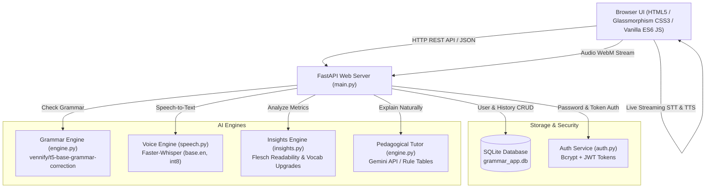

<div align="center">

# 🌟 GrammarLens PRO
### Intelligent Linguistic Mastery & AI-Powered Grammar Correction Platform

[](https://www.python.org/)
[](https://fastapi.tiangolo.com/)
[](https://pytorch.org/)
[](https://huggingface.co/)
[](https://github.com/SYSTRAN/faster-whisper)
[](LICENSE)

*An end-to-end, full-stack AI writing tutor that detects, corrects, categorizes, and pedagogically explains English grammar mistakes while offering live voice dictation and pronunciation.*

---

</div>

## 📖 Table of Contents
- [About The Project](#-about-the-project)
- [Key Features](#-key-features)
- [System Architecture](#-system-architecture)
- [Technology Stack](#-technology-stack)
- [Project Structure](#-project-structure)
- [Installation & Setup](#-installation--setup)
- [How to Use](#-how-to-use)
- [AI Models & Parameters](#-ai-models--parameters)
- [Security & Authentication](#-security--authentication)
- [License](#-license)

---

## 💡 About The Project

Standard spell-checkers merely flag typos or swap words blindly without explaining the underlying grammar rules. 

**GrammarLens PRO** functions as an **interactive, pedagogical English tutor**:
1. **Context-Aware Sequence-to-Sequence Correction**: Powered by a fine-tuned **T5 Transformer**, it captures long-distance syntactic dependencies to rewrite ungrammatical sentences into polished, natural English.
2. **Syntactic Mistake Classification**: Automatically isolates errors and categorizes them into specific linguistic types (*Subject-Verb Agreement, Verb Tense, Articles, Prepositions, Pluralization, Spelling, etc.*).
3. **Adaptive CEFR-Level Tutoring**: Adapts grammatical explanations based on learner proficiency (**Beginner, Intermediate, or Advanced**).
4. **Multimodal Voice Suite**: Real-time live voice dictation (Speech-to-Text) and native speech synthesis (Text-to-Speech) for acoustic reinforcement and auditory learning.
5. **Vocabulary Elevation & Readability**: Computes mathematical **Flesch Reading Ease** scores, determines CEFR level mapping (A1 to C2), and recommends elevated academic synonyms.

---

## ✨ Key Features

### 1. Neural Grammar Error Correction (GEC)
* **T5 Encoder-Decoder Transformer**: Treats grammatical correction as translation from ungrammatical English to fluent English.
* **Beam Search Decoding (`num_beams=4`)**: Searches for globally optimal sentence completions while avoiding greedy token traps.
* **Repetition Penalties**: Enforces `no_repeat_ngram_size=3` and `repetition_penalty=1.3` to avoid looping phrases.
* **Dynamic Length Bounding**: Dynamically scales generation space to prevent hallucination on short inputs.

### 2. Syntactic Diff Classification & Educational Cards
* Uses Ratcliff-Obershelp pattern matching (`difflib.SequenceMatcher`) combined with deterministic linguistic tables (`ARTICLES`, `PREPOSITIONS`, `VERB_FAMILIES`, `_IRREGULAR_PLURALS`).
* Displays before/after diff tags (`<del>original</del> → <ins>replacement</ins>`).
* Provides 1-click **"Apply"** for individual fixes or **"Apply All"** to elevate the entire passage.
* On-demand **"✦ Explain more naturally"** button powered by Gemini GenAI with graceful offline template fallback.

### 3. Multimodal Voice Suite
* **Voice Input (Speech-to-Text / Dictation)**:
  * **Real-time live streaming**: Words appear verbatim in the editor in real time as you speak via W3C Web Speech API.
  * **Offline Neural Transcriber**: Integrated **Faster-Whisper** (`base.en`, `int8` CPU quantization) for local, browser-agnostic speech-to-text.
  * **Verbatim Preservation Guarantee**: Disables language-model smoothing (`beam_size=1`, deterministic greedy decoding) so ungrammatical spoken drafts (*"He go to school"*) are **never auto-corrected beforehand**.
  * **Atomic Auto-Stop**: Clicking **Analyze & Elevate** immediately shuts off the microphone hardware, stops the timer, and analyzes the raw draft without delayed overwrites.
* **Voice Output (Text-to-Speech / Pronunciation)**:
  * `🔊 Listen` on draft text to hear original phrasing.
  * `🔊 Listen` on polished text to hear fluent English cadence and sentence stress ($0.95\times$ speed).
  * `🔊 Hear Fix` on correction cards to pronounce specific grammar corrections.
  * Built-in Chromium watchdog prevents speech synthesis queue freezes.

### 4. Linguistic Analytics & Vocabulary Elevation
* **Flesch Reading Ease Formula**: Evaluates sentence structure and syllable density.
* **CEFR Mapping**: Classifies passages into official CEFR tiers (A1, A2, B1, B2, C1, C2).
* **Automated Synonym Engine**: Backed by a programmatic WordNet + Zipf-frequency dictionary (`vocab_dictionary.json`), recommending contextually appropriate, professional replacements for overused words.

### 5. User History & Trajectory Drawer
* Persistent tracking of past submissions, original drafts, polished outputs, error counts, and CEFR progress in a local SQLite database.

---

## 🏛 System Architecture



---

## 🛠 Technology Stack

| Layer | Technology | Details |
| :--- | :--- | :--- |
| **Backend Framework** | **FastAPI** (Python 3.10 / 3.11) | Asynchronous ASGI web framework |
| **Server Engine** | **Uvicorn** | High-performance ASGI production server |
| **Grammar Model** | **T5-base** (`vennify/t5-base-grammar-correction`) | 220M parameter Seq2Seq Transformer |
| **Speech-to-Text** | **Faster-Whisper** (`base.en`) | CTranslate2 runtime with `int8` CPU quantization |
| **Multimedia Demuxer**| **PyAV** | In-memory audio decoding (no external ffmpeg binary required) |
| **Lexical Resources** | **NLTK WordNet** & **wordfreq** | Zipf-frequency rarity scoring for vocabulary elevation |
| **Database** | **SQLite3** (`grammar_app.db`) | Lightweight, self-contained relational storage |
| **Authentication** | **PyJWT** & **Passlib (Bcrypt)** | Signed JWT bearer tokens with salted password hashes |
| **Frontend UI** | **Vanilla HTML5, CSS3, ES6+ JS** | Responsive luxury dark glassmorphism (zero npm dependencies) |
| **Client Voice APIs** | **W3C Web Speech & MediaRecorder** | Native in-browser live dictation & speech synthesis |

---

## 📂 Project Structure

```
Grammar_checker(Pretrained_vennify)/
├── main.py                     # Central FastAPI application server & REST routing
├── engine.py                   # T5 Transformer Grammar engine, rule tables & explainer
├── speech.py                   # Faster-Whisper ASR engine (int8 CPU quantized)
├── insights.py                 # Flesch readability, CEFR mapping & vocabulary enhancements
├── auth.py                     # JWT token handling & bcrypt password encryption
├── database.py                 # SQLite database schema, initialization & query helpers
├── grammar_app.db              # SQLite database file (created automatically)
├── vocab_dictionary.json       # Lexical synonym upgrade mappings
├── build_vocab_dictionary.py   # Script generating vocab_dictionary.json from WordNet & wordfreq
├── requirements.txt            # Python dependencies
├── static/                     # Frontend web application
│   ├── index.html              # Modern glassmorphism UI layout
│   ├── style.css               # Luxury dark theme, animations & responsive grid
│   └── app.js                  # Frontend controller (STT, TTS, REST, UI state)
└── README.md                   # Project documentation
```

---

## 🚀 Installation & Setup

### Prerequisites
* **Python 3.10** or **Python 3.11** installed on your system.
* A working microphone and speaker for voice features.

### Step-by-Step Installation

1. **Clone the Repository**
   ```bash
   git clone https://github.com/your-username/GrammarLens-PRO.git
   cd GrammarLens-PRO
   ```

2. **Create and Activate a Virtual Environment**
   * **Windows (PowerShell):**
     ```powershell
     python -m venv venv
     .\venv\Scripts\Activate.ps1
     ```
   * **macOS / Linux:**
     ```bash
     python3 -m venv venv
     source venv/bin/activate
     ```

3. **Install Dependencies**
   ```bash
   pip install --upgrade pip
   pip install -r requirements.txt
   ```

4. **(Optional) Set Gemini API Key for Natural AI Explanations**
   * If you wish to enable on-demand conversational explanations via Gemini, set the environment variable:
     * **Windows (PowerShell):** `$env:GEMINI_API_KEY="your_api_key_here"`
     * **Linux / macOS:** `export GEMINI_API_KEY="your_api_key_here"`
   * *(Note: If unset, the app automatically falls back to built-in rule templates with zero errors).*

5. **Run the Application**
   ```bash
   python main.py
   ```
   *Or with Uvicorn directly:*
   ```bash
   uvicorn main:app --host 127.0.0.1 --port 8000 --reload
   ```

6. **Open in Your Browser**
   * Navigate to: `http://127.0.0.1:8000`

---

## 🎯 How to Use

1. **Target Level Selection**:
   * Choose your desired feedback depth in the top navigation bar: **Beginner**, **Intermediate**, or **Advanced**.
2. **Drafting or Voice Input**:
   * Type or paste your English text into the **Source Text** box.
   * *Alternatively*, click **`🎤 Voice Input`** to dictate your draft live. The app captures your exact spoken words word-for-word without premature auto-correction.
3. **Analyze & Elevate**:
   * Click **`✦ Analyze & Elevate`** (if dictating, recording stops automatically).
   * Review detected errors on interactive educational cards.
   * View the elevated, polished text in the **Polished Output** box.
4. **Listening & Pronunciation**:
   * Click **`🔊 Listen`** on the Source Text or Polished Output to hear the sentence read aloud with natural English pronunciation.
   * Click **`🔊 Hear Fix`** on any correction card to hear the specific change.
5. **Vocabulary Elevation**:
   * Switch to the **Vocabulary Upgrades** tab to replace common words with professional alternatives.
6. **Apply Corrections**:
   * Click **"Apply"** on individual cards, or click **"Apply All"** to update your entire draft.

---

## ⚙️ AI Models & Parameters

### Grammar Correction (`engine.py`)
```python
outputs = model.generate(
    **inputs,
    max_length=dynamic_max_length,  # min(256, max(10, input_len * 3))
    num_beams=4,                    # Beam search evaluating top 4 sequence candidates
    early_stopping=True,            # Halts as soon as all beams finish
    no_repeat_ngram_size=3,         # Prevents repeating 3-word n-gram loops
    repetition_penalty=1.3          # Discourages duplicate token emissions
)
```

### Speech-to-Text Transcription (`speech.py`)
```python
segments, _ = model.transcribe(
    audio_path,
    language="en",                  # Fixed English acoustic routing
    beam_size=1,                    # Greedy search for literal acoustic decoding
    best_of=1,
    temperature=0.0,                # Deterministic argmax output
    condition_on_previous_text=False,# Eliminates hallucination compounding
    initial_prompt="Transcribe speech verbatim. Do not correct grammar.",
    vad_filter=False                # Prevents dropping brief 1-2 word learner phrases
)
```

---

## 🔒 Security & Authentication

* **Password Security**: Passwords are encrypted using **bcrypt** with salted cryptographic hashing via `passlib`.
* **Session Management**: Authenticated routes utilize **JSON Web Tokens (JWT)** with HMAC-SHA256 signatures passed in `Authorization: Bearer <token>` headers.
* **Payload Sanitation**: Audio uploads to `/api/speech-to-text` are strictly capped at **10 MB** to protect against buffer overflow or denial-of-service memory exhaustion.
* **Local Data Sovereignty**: All models and history databases run locally on your machine, ensuring complete privacy of text and voice data.

---

## 📄 License

Distributed under the **MIT License**. See `LICENSE` for more information.

---

<div align="center">

Developed with ❤️ using FastAPI, Hugging Face Transformers, and Faster-Whisper.  
*Star ⭐ this repository if you find it helpful!*

</div>
